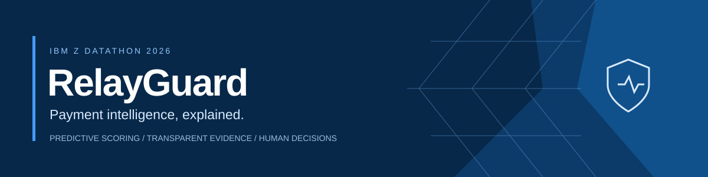
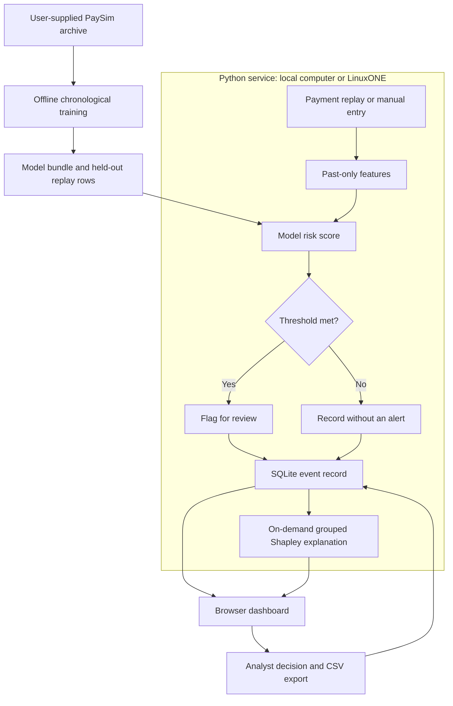

<p align="center">
  
</p>

<p align="center"><strong>Observe payments. Understand risk. Make informed decisions.</strong><br>A fraud-review workspace built for IBM Z Datathon 2026.</p>

<p align="center"><a href="#quick-start">Run locally</a> · <a href="#using-the-platform">Platform guide</a> · <a href="#how-the-ai-model-was-trained">Model training</a> · <a href="#evaluation">Evaluation</a> · <a href="DEPLOY.md">LinuxONE deployment</a></p>

---

## Overview

RelayGuard helps a fraud analyst move from an incoming payment to a documented review decision. It scores transactions, surfaces higher-risk activity, explains the factors behind each model score, and records the analyst's response in an exportable review log.

The project addresses **Theme 1: Real-Time AI for Critical Decisions**. Its distinguishing feature is the combination of past-only payment-stream context, exact grouped model explanations, and a human review workflow in one application. The interface uses a blue-and-white visual system, live activity charts, accessible motion, and expandable supporting information.

This is a functioning hackathon prototype using synthetic financial data. It does not connect to a bank, move funds, block payments, authenticate staff, or establish that a transaction is actually fraudulent.

| Capability | What the analyst gets |
| :--- | :--- |
| Payment replay | Held-out transactions arriving individually or through timed replay |
| Risk scoring | A model score and a flag when the recorded threshold is met |
| AI explanations | Positive and negative feature-group contributions to the actual score |
| Investigation workspace | Payment details, observed context, review status, and analyst notes |
| Manual testing | A form for scoring a hypothetical payment with available session history |
| Evaluation | Precision, recall, F1, average precision, and error counts |
| Review exports | CSV decisions, notes, model versions, and recorded thresholds |
| Runtime visibility | Health and architecture information for the running server |

## Architecture

One Python service serves the website, API, model, and SQLite database. There is no frontend build step, external AI service, API key, or separately managed database.



**Stack:** Python, FastAPI, Uvicorn, scikit-learn, NumPy, joblib, SQLite, and HTML/CSS/JavaScript. Streaming is simulated through replay requests rather than Kafka. A real integration would supply an ordered transaction feed to the backend.

## Quick start

Use **Python 3.11+**; Python 3.12 is the reference development environment. Installation needs internet access. Once dependencies are installed, the app runs without external services.

### Windows PowerShell

Open PowerShell in the extracted repository folder:

```powershell
python --version
python -m venv .venv
.\.venv\Scripts\python.exe -m pip install -r requirements.txt
.\.venv\Scripts\python.exe run.py
```

### Linux or macOS

```bash
python3 -m venv .venv
.venv/bin/python -m pip install -r requirements.txt
.venv/bin/python run.py
```

Open **http://127.0.0.1:8000**. Keep the terminal open; press **Ctrl+C** to stop. For another port, use `run.py --port 8001` and open that port in the browser.

**Fresh-clone behavior:** model binaries and raw data are excluded. Without `runtime/model.joblib`, RelayGuard creates a small generated-data demonstration in memory. The source banner identifies this mode. Its scores are **not** the PaySim evaluation below. Follow the training instructions to enable the PaySim model and held-out feed.

If Windows opens `start-local.ps1` in an editor, use the PowerShell commands above. After setup, `start-local.cmd` also launches the local environment. A separate Windows portable executable distribution exists; this repository contains source code.

For **Ubuntu on IBM LinuxONE / s390x**, follow [DEPLOY.md](DEPLOY.md), which uses native scientific packages rather than Windows or x86 binaries.

## Using the platform

### Example: reviewing a suspicious transfer

1. **Open Payments.** Check the source banner: generated demonstration, PaySim, or uploaded data. This is one simulated bank workspace with no login form or bank connection.
2. **Start the feed.** Choose **Score one transaction** for a controlled demonstration or **Start replay** for successive events. Payments, scores, alert counts, and remaining rows update as events are processed.
3. **Watch activity.** Recent scores appear against the current threshold. A flag requests review; it does not confirm fraud. Newly actionable flags briefly draw attention to the review navigation.
4. **Open a payment.** Inspect its ID, simulation step, type, amount, sender, recipient, recorded threshold, and observed-history context. Search and the review view help locate records.
5. **Read the explanation.** Compare the reference score with groups that increased or reduced the model score. The summary explains the result against the recorded threshold. Historical observations and model attribution provide different kinds of evidence.
6. **Record a decision.** Choose **Needs investigation**, **Dismissed**, or **Unreviewed**, and add a note. This updates the review record; it performs no banking action.
7. **Export the log.** The CSV includes payment fields, score, flag, review, note, model version, and threshold. Opened explanations contribute their method and summary; unopened explanation columns remain blank.

For example, an unusually large `TRANSFER` to a new recipient might be flagged. The analyst checks which groups actually raised its model score and records a note to verify the recipient. This scenario does not guarantee a particular score: the result depends on the fitted model and preceding history.

### Manual payment form

| Input | Expected value |
| :--- | :--- |
| Transaction ID | Unique, at most 100 characters |
| Simulation step | Non-negative whole-hour step, at least the latest processed step |
| Type | `PAYMENT`, `TRANSFER`, `CASH_OUT`, `CASH_IN`, or `DEBIT` |
| Amount | Finite positive number; no currency conversion is performed |
| Sender / recipient | Different non-empty identifiers, at most 100 characters each |

The output includes the payment, a score between 0 and 1, a threshold-based flag, context observations, model version, review status, and scoring latency. Fraud labels are not needed for inference.

Manual tests use available session history, not the complete source stream. Their results therefore differ in context from held-out replay rows with trusted full-stream snapshots. Submitting a future step prevents earlier replay until active history is reset.

### Settings, reset, and retraining

- **Threshold:** strictly between 0 and 1. Lower values normally create more alerts. Changes affect future scores; old records keep their original thresholds. Overrides persist for the same model version.
- **Reset:** clears active events and restarts replay while retaining the model and earlier archived model-version records. Export important active reviews first.
- **CSV training:** replaces the model and clears active events. Limit: 40 MB and 150,000 rows. This is a separate generic context-model trainer, not the sequence-v4 archive experiment.

CSV columns: `step,type,amount,nameOrig,nameDest,isFraud`; `sender`/`recipient` aliases are accepted, and `id` is optional. Supply at least 100 rows, ten distinct time steps, and both classes in every chronological partition. This path uses 60/20/20 partitions by unique steps, balanced training, and validation-only thresholds. Use the offline archive trainer for the full PaySim dataset.

## How the AI model was trained

### 1. Dataset and prediction task

The archive experiment uses **PaySim**, synthetic mobile-money transactions. The supplied archive contains **6,362,620 rows and 8,213 fraud labels**. Download it separately from the [dataset page](https://www.kaggle.com/datasets/ealaxi/paysim1), review its terms, and credit the [PaySim authors](https://github.com/EdgarLopezPhD/PaySim).

This is supervised classification: `isFraud` labels teach the model to distinguish patterns in engineered numeric features. It is not a language model or a separately trained anomaly detector.

### 2. Chronological splitting and sampling

`train_sequence.py` streams the ZIP's single CSV without extracting it. It preserves file order and uses original zero-based row index `i`:

| Partition | Selection | Reference rows | Reference frauds |
| :--- | :--- | ---: | ---: |
| Train | `step < 400`; every fraud plus legitimate rows with `i % 24 == 0` | 244,120 | 4,461 |
| Validation | `400 <= step < 555`; `i % 8 == 1` | 51,549 | 211 |
| Test | `step >= 555`; `i % 8 == 3` | 24,264 | 268 |

Training is enriched with fraud to reduce fitting cost. Validation and test selection are label-independent. The test row rule differs from the earlier published V1/V2 tests. This is a temporal split, not a random shuffle. Counts describe the supplied archive; the file's within-hour order is assumed rather than independently verified.

### 3. Constructing 23 past-only features

`History` and `StreamContext` in `engine.py` calculate features **before adding the current event**:

| Group | Features | Count |
| :--- | :--- | ---: |
| Amount | `log1p(amount)` | 1 |
| Type | One-hot indicators for five payment types | 5 |
| Sender | Prior outgoing count, average amount, amount relative to average, unseen-recipient indicator | 4 |
| Time | Hour modulo 24 plus sine/cosine daily cycle | 3 |
| Recipient | Prior incoming count, total received, distinct senders, sender seen before | 4 |
| Stream | Previous-hour volume, current-hour count so far, matching-transfer count and delay, matching-cash-out count, previous-hour transfer volume | 6 |

Counts, amounts, and ratios use logarithmic transforms where implemented. Matching amount events use cent-rounded amounts within a rolling 24-step window; transfer delay is capped at 25 hours. IDs are lookup keys for history, not raw prediction features. Labels, existing fraud flags, and **all balance columns** are excluded from prediction features.

Six stream features use **all preceding source rows**, computed before sampling. Sender/recipient histories use retained observations. Internal replay snapshots retain the full-stream context; external manual/CSV inputs cannot inject them. Sampled account history is therefore not described as complete personalized behavior.

### 4. Fitting boosted decision trees

The model is scikit-learn's `HistGradientBoostingClassifier`, an ensemble of trees fitted sequentially to improve classification loss. Numeric features do not need a separate scaling step here.

| Parameter | Sequence candidates |
| :--- | :--- |
| Boosting iterations / learning rate | 250 / 0.06 |
| Maximum leaf nodes / depth | 23 / 7 |
| Minimum samples per leaf | 25 |
| L2 regularization | 3 |
| Early stopping | Disabled; chronological validation handled explicitly |
| Random seed | 2028 |
| Class weights tested | None; legitimate:fraud = 1:3; legitimate:fraud = 1:10 |

The published run selected **Sequence cost-aware**, with 1:10 weights. A 17-feature V2-style reference is loaded from a trusted artifact or fitted natively if absent. A fresh native reference may differ from a preserved earlier artifact.

### 5. Validation, thresholds, and promotion

For each candidate, the threshold maximizes validation F1 subject to **false-positive rate <= 0.5%** and recall at least the reference's validation recall. Threshold ties prefer precision, then recall. Only candidates improving reference validation F1 are eligible; candidate selection maximizes validation F1, then precision.

The selected candidate and threshold are fixed before final-test predictions. The script then compares that candidate and the reference on the same test. **A separate promotion gate requires final-test F1 to improve before replacing the active model.** Thus test results influence release, although they do not choose the candidate or threshold. A stricter future evaluation needs another untouched confirmation set after release decisions; do not repeatedly tune against this published test.

The promoted `runtime/model.joblib` contains the estimator, feature indices, threshold, version, reports, replay rows, seed history, and protocol. Cached preparation and candidate fits speed up reruns. Use a fresh runtime after changing parameters, code, or dependency versions because cached fits are not parameter-aware.

### 6. Reproduce training

Stop the server before replacing its model. Keep the downloaded ZIP outside the repository.

**Windows PowerShell:**

```powershell
$env:OMP_NUM_THREADS = "2"
$env:OPENBLAS_NUM_THREADS = "2"
.\.venv\Scripts\python.exe -u train_sequence.py "C:\path\to\archive.zip"
.\.venv\Scripts\python.exe run.py
```

**Linux/macOS after dependency setup:**

```bash
OMP_NUM_THREADS=2 OPENBLAS_NUM_THREADS=2 .venv/bin/python -u train_sequence.py /path/to/archive.zip
.venv/bin/python run.py
```

The initial full-archive pass can be quiet. Wait for the final report, check `promoted` and `runtime/model.joblib`, then restart. A clean experiment can fail its improvement gate and produce no promoted model. The generated-data fallback is not proof that PaySim training succeeded.

At `/api/health`, verify `paysim-sequence-v4`. Native reports are saved as `runtime/sequence-evaluation.json` and, on promotion, `runtime/paysim-evaluation.json`. They do not overwrite the committed reference [EVALUATION.json](EVALUATION.json). For an independent run, use `--runtime /path/to/fresh-runtime` and set `RELAYGUARD_RUNTIME` to that directory when serving.

## Evaluation

These are the **published Windows development results**, recorded in [EVALUATION.json](EVALUATION.json), not newly measured LinuxONE results or real-bank benchmarks. Dependency versions and the reference artifact can affect reproduction.

Both columns use the same **24,264-row test: 268 frauds and 23,996 legitimate payments**.

| Metric | Previous V2 reference | Sequence V4 |
| :--- | ---: | ---: |
| Precision | 53.33% | **96.23%** |
| Recall | 47.76% | **76.12%** |
| F1 | 0.5039 | **0.8500** |
| Average precision | 0.4747 | **0.8776** |
| True positives: frauds caught | 128 | **204** |
| False positives: legitimate payments flagged | 112 | **8** |
| False negatives: frauds missed | 140 | **64** |
| True negatives | 23,884 | **23,988** |
| False-positive rate | 0.4667% | **0.0333%** |
| Threshold | 0.897739 | **0.985937** |

**Interpretation:** precision measures the share of alerts that are fraud in this labeled test; recall measures the share of fraud caught. F1 balances both. Average precision summarizes ranking over thresholds and is not identical to trapezoidal PR-AUC. V4 still misses 64 frauds.

Accuracy calculated from these counts is 99.70%, but always predicting legitimate already gives 98.90%. Precision, recall, and false alerts better communicate the review tradeoff. A score of `0.99` is **not** a validated 99% fraud probability: scores are uncalibrated and training prevalence was changed.

The reference V4 validation result is precision 93.22%, recall 78.20%, F1 0.8505, and 12 false positives. Validation constraints do not guarantee future results. The V2/V4 comparison changes features, weights, and policy together; it is not a controlled single-feature ablation.

## How explanations work

`explanations.py` directly implements exact **grouped interventional Shapley** attribution, with no LLM or SHAP package dependency:

1. Select up to 32 evenly spaced training observations as the reference.
2. Group features into amount, type, sender, timing, recipient, and stream.
3. Evaluate all `2^6 = 64` group coalitions, replacing absent groups with reference values.
4. Average each coalition's scores and calculate Shapley-weighted marginal effects.
5. Require **baseline + contributions = saved score** within numerical tolerance, or refuse the explanation.

Positive contributions raise the score relative to the reference; negative ones reduce it. The summary uses those measured effects and the recorded threshold. Each event stores its original feature vector and model fingerprint, preventing later history or policy changes from rewriting an explanation. Attribution is computed on demand and cached; its first request can be slower.

These effects explain model behavior, not causes or proof of fraud. Class enrichment affects the reference baseline, and masking correlated transformed features can create artificial combinations.

## IBM LinuxONE

The project was brought up on an Ubuntu 24.04 LinuxONE VM reporting `s390x`, Python 3.12.3, scikit-learn 1.4.1.post1, and FastAPI 0.125.0. The operator confirmed website access through an SSH tunnel. The remote evaluation JSON has not been incorporated here.

LinuxONE runs the Python service and CPU ML workload on the supplied enterprise Linux platform. This project does not claim measured platform performance advantages, integrated on-chip AI acceleration, platform-specific encryption, or production throughput. Show the organiser's instance dashboard alongside application health: architecture alone does not attest the hosting provider.

See [DEPLOY.md](DEPLOY.md) for native installation, training, startup, and browser access.

## Repository guide

| Path | Responsibility |
| :--- | :--- |
| `app.py` | Routes, scoring workflow, reviews, SQLite, exports |
| `engine.py` | Normalization, past-only features, prediction, metrics |
| `explanations.py` | Grouped model attribution and reconciliation |
| `train_sequence.py` | Current sequence-v4 archive training |
| `improve_model.py`, `train_v3.py`, `prepare_paysim.py`, `models.py` | Earlier experiments and shared helpers |
| `run.py` | Single-process entry point |
| `static/` | Website source; no build step |
| `DEPLOY.md`, `docs/` | Deployment, API, acknowledgements, branding |
| `EVALUATION.json` | Published reference result |
| `requirements*.txt` | General, LinuxONE web, test, and reference versions |
| `test_app.py`, `test_frontend_alerts.cjs` | Backend/explanation and attention-logic checks |

Use `train_sequence.py` for V4. Earlier scripts remain for provenance; some expect prior experiment artifacts. `portable_launcher.py` supports a separate packaged Windows build, not normal source startup. `requirements-lock.txt` records the earlier Windows environment, not a cross-platform installation prescription.

## Verification and API

Install `requirements-dev.txt` into the configured environment, then run:

```bash
python -m unittest -v test_app.py
```

Use the environment's full Python path if it is not activated. Tests use a separate temporary runtime and cover replay/review/export, validation, ordering, label exclusion, stream expiry, settings, CSV training, and explanation consistency. They do not evaluate the full PaySim archive or real-bank performance.

Optional attention-logic check, with Node.js installed:

```bash
node test_frontend_alerts.cjs
```

Node.js is not needed to run the site. Interactive API documentation is at `/docs`; see [docs/API.md](docs/API.md) for route details. [FRONTEND.md](FRONTEND.md) describes interface implementation and accessibility.

## Limits and responsible use

- Synthetic data and simulation-time patterns may expose simulator regularities. Real deployment needs representative validation, full live context, calibration, drift monitoring, and operational controls.
- No production authentication, authorization, tenant isolation, TLS termination, or bank connector is implemented. Keep the demo local or behind its SSH tunnel.
- SQLite and in-memory history support one application process. Use **one worker**; multiple workers would maintain inconsistent histories.
- Load only trusted joblib models and caches. The website accepts training CSV, not serialized model uploads.
- Back up reviews before replacing models. Model-version changes archive prior events; same-version retraining is not a complete migration strategy.
- No throughput benchmark is published. UI scoring duration excludes network time and on-demand explanation work.

## References and acknowledgements

- [PaySim dataset](https://www.kaggle.com/datasets/ealaxi/paysim1) and [authors](https://github.com/EdgarLopezPhD/PaySim). E. A. Lopez-Rojas, A. Elmir, and S. Axelsson, *PaySim: A financial mobile money simulator for fraud detection*, EMSS, 2016.
- [Histogram gradient boosting](https://scikit-learn.org/stable/modules/generated/sklearn.ensemble.HistGradientBoostingClassifier.html) and [average precision](https://scikit-learn.org/stable/modules/generated/sklearn.metrics.average_precision_score.html).
- [SHAP exact explainer](https://shap.readthedocs.io/en/latest/generated/shap.ExactExplainer.html), a methodological reference; grouped enumeration is implemented locally.
- [LinuxONE resources](https://github.com/linuxone-community-cloud/technical-resources) and [event ML environment](https://github.com/linuxone-community-cloud/jupyter-lab-ml).
- [Dependency and resource acknowledgements](docs/ACKNOWLEDGEMENTS.md).

Raw datasets, trained models, private keys, credentials, and local review history are not distributed here. Third-party tools and data retain their own terms. No project-source license is specified by this repository.
